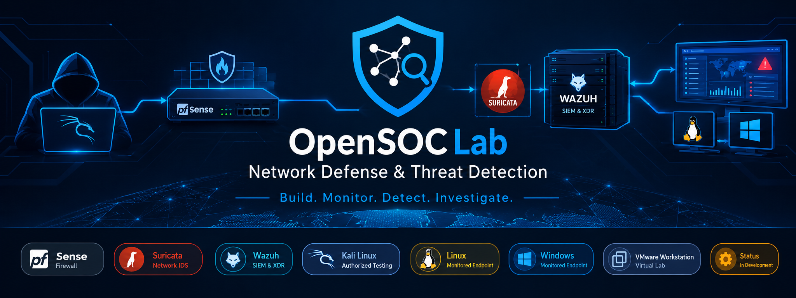
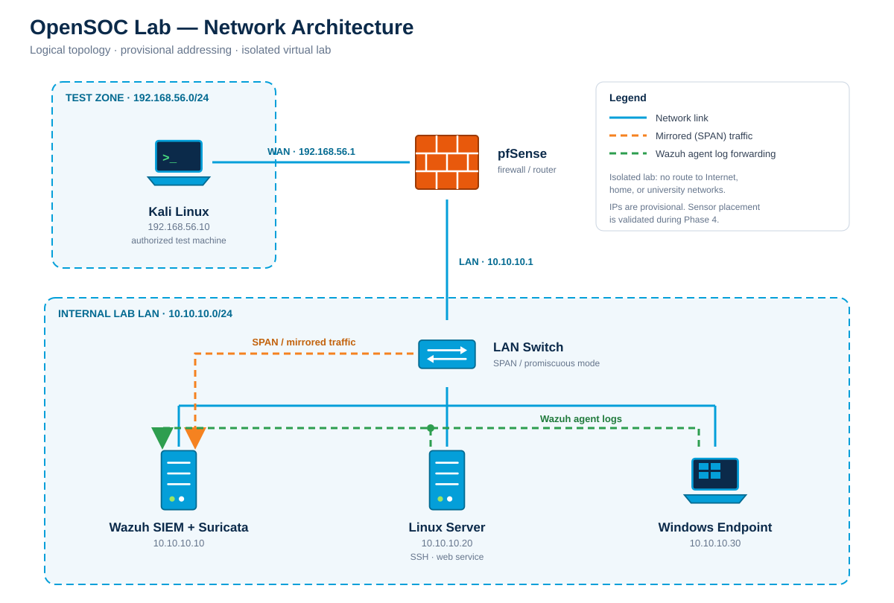

# OpenSOC Lab — Network Defense & Threat Detection

<p align="center">
  
</p>

<p align="center">
  
  
  
  
  
  
  
  
</p>

**Build. Monitor. Detect. Investigate.**

OpenSOC Lab is a hands-on cybersecurity project focused on network defense, firewall administration, intrusion detection, centralized security monitoring, and incident investigation in an isolated virtual environment.

The project integrates **pfSense**, **Suricata IDS**, and **Wazuh SIEM** to investigate suspicious network activity, collect Linux and Windows security events, validate detection capabilities, and document remediation strategies.

Developed as part of a Firewalls & Intrusion Detection Systems (IDS) project, OpenSOC Lab is also designed to serve as a practical cybersecurity portfolio demonstrating infrastructure configuration, security monitoring, detection validation, troubleshooting, and technical documentation.

> **Project status:** In development. Implementation status and detection results are updated only after testing and verification.

---

## Table of Contents

- [Objectives](#objectives)
- [Project Scope](#project-scope)
- [Architecture](#architecture)
- [Network Plan](#network-plan)
- [Technology Stack](#technology-stack)
- [Security Monitoring Workflow](#security-monitoring-workflow)
- [Planned Security Tests](#planned-security-tests)
- [Detection Matrix](#detection-matrix)
- [SIEM Dashboard Requirements](#siem-dashboard-requirements)
- [Incident Investigation](#incident-investigation)
- [Repository Structure](#repository-structure)
- [Implementation Roadmap](#implementation-roadmap)
- [Expected Deliverables](#expected-deliverables)
- [Lab Constraints](#lab-constraints)
- [Lessons Learned](#lessons-learned)
- [Disclaimer](#disclaimer)

---

## Objectives

The main objectives of OpenSOC Lab are to:

- Configure firewall policies and network segmentation using pfSense.
- Deploy Suricata as a Network Intrusion Detection System (NIDS).
- Deploy Wazuh for centralized security event collection, analysis, and alerting.
- Integrate Suricata events into the SIEM.
- Collect and investigate Linux and Windows endpoint logs.
- Monitor SSH authentication attempts and web server activity.
- Conduct controlled security tests in an isolated laboratory.
- Validate detections using logs, alerts, timestamps, and supporting evidence.
- Investigate incidents and document appropriate remediation measures.
- Develop technical documentation suitable for academic assessment and a professional portfolio.

## Project Scope

The project follows five technical parts based on the SOC mini-project assignment, followed by a portfolio documentation phase.

| Part | Scope |
|---|---|
| 1 | Network topology, segmentation, and pfSense firewall configuration |
| 2 | Wazuh SIEM and Suricata IDS deployment and integration |
| 3 | Linux and Windows endpoint log collection |
| 4 | Controlled SSH brute-force and web traffic flood testing |
| 5 | SIEM dashboard development and incident reporting |
| 6 | Portfolio documentation, final validation, and presentation |

The primary SIEM implementation is **Wazuh**. ELK is an alternative mentioned in the assignment, but this repository documents the Wazuh implementation.

The laboratory focuses on defensive security and detection validation rather than offensive tool development.

---


## Architecture

The planned environment consists of a firewall, an IDS sensor, a SIEM platform, and monitored endpoints.

<p align="center">
  
</p>

**Architecture note:** This diagram represents the intended logical architecture, not proof of a fully implemented topology. Actual interface assignments, traffic paths, sensor placement, and event integration must be documented and validated during implementation.

Suricata must receive traffic relevant to the tests. A sensor installed on a network does not automatically see every packet. Depending on the virtual network design, additional configuration such as promiscuous mode or traffic mirroring may be required. LAN mirroring is treated as an optional advanced exercise in the assignment.

### Component responsibilities

| Component | Responsibility |
|---|---|
| pfSense | Network segmentation, traffic filtering, firewall rules, and firewall logging |
| Suricata | Network traffic inspection and signature-based intrusion detection |
| Wazuh | Centralized event collection, analysis, alerting, and visualization |
| Linux endpoint | SSH authentication monitoring and optional web service logging |
| Windows endpoint | Windows Security event monitoring and optional IIS logging |
| Kali Linux | Controlled security test traffic generation |
| SIEM dashboard | Security event analysis, detection validation, and investigation |

---

## Network Plan

The following addressing scheme is the **provisional reference plan** from the project design. It must be checked against the actual VMware network configuration before deployment.

| Machine | Role | Zone | Planned IP address |
|---|---|---|---|
| pfSense | Firewall and router | WAN / LAN | `192.168.56.1` / `10.10.10.1` |
| Kali Linux | Authorized test machine | Test side | `192.168.56.10` |
| Wazuh SIEM | SIEM and Suricata host | LAN | `10.10.10.10` |
| Linux endpoint | SSH target and optional web server | LAN | `10.10.10.20` |
| Windows endpoint | Monitored endpoint and optional IIS server | LAN | `10.10.10.30` |

**Addressing note:** These addresses are planned values, not confirmed active assignments. The WAN subnet is private, so pfSense WAN settings and routing must be reviewed carefully. Any required exceptions must be limited to the isolated lab.

### Network design requirements

- Separate the test network from the internal monitored LAN.
- Configure pfSense interfaces and routing according to the actual virtual topology.
- Apply a restrictive firewall policy and explicitly document necessary exceptions.
- Enable firewall logging for relevant allowed and blocked traffic.
- Validate Suricata's visibility of the traffic used in the tests.
- Keep the laboratory isolated from home, university, and public networks.
- Document the actual topology and any differences from the reference design.

The final network configuration will be recorded in [`docs/network-design.md`](docs/network-design.md).

---

## Technology Stack

| Technology | Purpose |
|---|---|
| pfSense | Firewall administration, traffic filtering, and network segmentation |
| Suricata | Network intrusion detection (NIDS) |
| Wazuh | SIEM, security event analysis, and alerting |
| Linux | Server authentication and system log collection |
| Windows | Endpoint security and authentication monitoring |
| Kali Linux | Controlled security testing |
| VMware Workstation | Virtualization and laboratory networking |
| Mermaid | Architecture diagrams in documentation |
| Git | Version control and project history |
| Markdown | Technical documentation and incident reports |

---

## Security Monitoring Workflow

The intended monitoring and investigation workflow is:

1. Generate controlled test activity inside the isolated laboratory.
2. Apply the configured pfSense firewall rules.
3. Inspect relevant network traffic with Suricata.
4. Generate Linux, Windows, and web server logs from the monitored endpoints.
5. Collect Suricata events and endpoint logs in Wazuh.
6. Examine the resulting events and determine whether a specific detection rule generated an alert.
7. Correlate evidence across firewall logs, network IDS events, and endpoint logs.
8. Record the outcome, identify detection gaps, and recommend remediation.
9. Repeat the test to verify whether the remediation improves detection or reduces exposure.

The actual visibility, log integration, detection behavior, and alert delay will be validated experimentally.

---

## Planned Security Tests

All tests are restricted to systems owned or explicitly authorized for testing within the isolated laboratory.

### Test A — SSH Brute-Force Detection

**Objective:** Evaluate the detection of repeated failed SSH authentication attempts against the lab Linux endpoint.

Planned activities:

- Generate controlled authentication failures using a dedicated test account.
- Observe Linux authentication logs.
- Check whether Wazuh generates a specific alert for the activity.
- Record the source IP, timestamps, relevant rule identifiers, and alert details.
- Determine whether the event is only logged or also classified as a security alert.
- Document remediation options, such as stronger authentication controls, rate limiting, or Fail2ban.

**Expected evidence:** Relevant authentication events, any resulting Wazuh alerts, and a documented explanation of the detection outcome.

### Test B — Abnormal Web Traffic / Flood Detection

**Objective:** Investigate how the monitoring stack handles abnormal traffic directed at a web service hosted inside the lab.

Planned activities:

- Generate controlled traffic against the designated lab web server.
- Observe request volume, connection behavior, and service response.
- Examine pfSense logs and counters.
- Inspect Suricata events and Wazuh alerts.
- Determine whether the traffic triggers an existing detection rule.
- Document any missed detections and possible improvements, such as suitable signatures, thresholds, or rate-limiting policies.

**Expected evidence:** Traffic observations, relevant logs, any resulting alerts, and a documented assessment of detection effectiveness.

A single-source traffic flood is not automatically a distributed denial-of-service (DDoS) attack. The report will describe the observed activity accurately, distinguishing a single-source DoS or application-layer flood from a genuinely distributed attack.

### Detection validation principles

For each test:

- Record the test start and end times.
- Identify the relevant source and destination.
- Preserve representative log entries and alert details.
- Record whether the expected detection occurred.
- Investigate the reason for missing or unexpected alerts.
- Document the corrective action and retest the detection.

An absence of alerts is a valid experimental result and must not be replaced with an assumed successful detection.

---

## Detection Matrix

The following matrix is a working template. Results will be added only after the corresponding tests have been performed.

| Test | Objective | Expected Detection | Observed Events | Alert Delay | False Positives / Misses | Remediation |
|---|---|---|---|---|---|---|
| SSH failed logins | Detect repeated authentication failures | Relevant Wazuh authentication alert, if the configured rule matches | TBD | TBD | TBD | TBD |
| Web traffic flood | Identify abnormal web or network traffic | Relevant Suricata alert or documented SIEM detection | TBD | TBD | TBD | TBD |

### Detection result classification

Each test will be documented using the following distinctions:

- **Detected:** The expected security alert was generated and verified.
- **Partially detected:** Relevant events were collected, but the expected alert or classification was missing.
- **Not detected:** The test occurred, but no relevant event or alert was found in the available monitoring data.
- **Inconclusive:** The available evidence is insufficient to determine the detection outcome.

These labels describe the observed result of each test, not the overall quality of the entire security platform.

The detailed results will be maintained in [`docs/detection-matrix.md`](docs/detection-matrix.md).

---

## SIEM Dashboard Requirements

The planned Wazuh dashboard will provide a consolidated view of security activity across the laboratory.

It should include:

1. **Authentication failures over time:** Failed authentication attempts from Linux and Windows endpoints.
2. **Web traffic activity:** Available request or connection metrics for the monitored web server.
3. **Recent Suricata alerts:** Relevant network detections, including their severity where available.
4. **Alert distribution:** A breakdown of alerts by type over the test period.
5. **Investigation evidence:** Event timestamps, source and destination details, rule identifiers, and endpoint identity where available.

Dashboard elements will be added and marked as completed only after the underlying data source and visualization have been validated.

---

## Incident Investigation

Two incident reports will be prepared as part of the project.

Each report will use the following structure:

### 1. Observation

- Date and time of the test.
- Source and target systems.
- Observed activity and relevant event identifiers.
- Representative firewall, IDS, and endpoint log evidence.

### 2. Analysis

- Probable activity or attack scenario.
- Evidence supporting the assessment.
- Security component responsible for detecting the activity.
- Detection rule or mechanism involved.
- Any missing alerts, logging gaps, or limitations.

### 3. Impact

- Observed effect on the target service.
- Relevant system resource usage or response behavior.
- Whether service disruption was actually observed.

### 4. Recommendations

- Appropriate configuration or detection improvements.
- Relevant preventive and defensive controls.
- Retesting steps to validate the recommendations.

Reports will distinguish observed facts from hypotheses. A generated traffic spike alone does not prove service disruption, and a raw log entry alone does not prove that a security alert was generated.

---

## Repository Structure

The repository is organized to separate architecture documentation, configuration, testing, evidence, and reporting.

```text
OpenSOC-Lab/
├── README.md
├── LICENSE
├── assets/
│   └── banner.png
├── docs/
│   ├── architecture.md
│   ├── network-design.md
│   ├── detection-matrix.md
│   └── troubleshooting.md
├── configs/
│   ├── pfsense/
│   ├── suricata/
│   └── wazuh/
├── tests/
│   ├── ssh-authentication/
│   └── web-traffic/
├── reports/
├── screenshots/
└── .gitignore
```

Directories and files will be added as implementation progresses. The tree represents the intended repository structure and does not imply that every file or configuration is already available.

### Documentation

- `architecture.md`: Logical architecture, component responsibilities, and traffic flow.
- `network-design.md`: Actual virtual network topology, addressing, interfaces, and connectivity validation.
- `detection-matrix.md`: Test cases, observed results, alert behavior, and remediation.
- `troubleshooting.md`: Problems encountered, root-cause analysis, and verified solutions.

### Configuration and evidence

Configuration files and screenshots must be sanitized before publication. Do not commit credentials, API keys, private tokens, real user data, or other sensitive information.

---

## Implementation Roadmap

The implementation follows the five technical parts of the academic assignment, followed by final portfolio preparation.

- [ ] **Phase 1 — Network Topology and pfSense**
  - Document the topology and addressing.
  - Configure the WAN/LAN interfaces and firewall rules.
  - Enable logging and validate allowed and blocked traffic.
  - Document the actual traffic path.

- [ ] **Phase 2 — Wazuh and Suricata**
  - Deploy Wazuh and validate its services.
  - Deploy Suricata in IDS mode.
  - Enable `eve.json` output.
  - Configure Suricata event ingestion into Wazuh.
  - Validate sensor visibility and event ingestion.

- [ ] **Phase 3 — Linux and Windows Log Integration**
  - Configure the Wazuh agents.
  - Validate Linux SSH authentication log collection.
  - Validate Windows Security event collection, including relevant authentication events.
  - Integrate web server logs.
  - Create an initial authentication visualization.

- [ ] **Phase 4 — Controlled Security Testing**
  - Perform the SSH brute-force detection test.
  - Perform the controlled abnormal web traffic test.
  - Collect logs and inspect alert behavior.
  - Document detection gaps and remediation.
  - Retest any detection improvements.

- [ ] **Phase 5 — Dashboard and Incident Reports**
  - Create the required SIEM dashboard visualizations.
  - Validate the dashboard against the recorded test events.
  - Produce both incident reports.
  - Complete the detection matrix and technical synthesis.

- [ ] **Phase 6 — Portfolio Publication**
  - Finalize diagrams and documentation.
  - Add sanitized evidence from verified tests.
  - Document troubleshooting and lessons learned.
  - Review the README, repository structure, and licensing.
  - Publish the project with accurate implementation-status claims.

---

## Expected Deliverables

The final deliverables are expected to include:

- Annotated network architecture and IP addressing documentation.
- Configured pfSense firewall rules and representative firewall logs.
- Verified Suricata event generation and packet-visibility assessment.
- Wazuh SIEM with validated event ingestion.
- Linux and Windows endpoint log collection.
- Controlled test procedures and recorded results.
- A detection matrix mapping test activity to observed events and alerts.
- A dashboard covering authentication activity, web traffic, and IDS alerts.
- Two incident reports with evidence, analysis, impact, and recommendations.
- Sanitized configuration files and reproducible setup documentation.
- Screenshots of verified dashboards, alerts, and relevant configuration.
- Troubleshooting notes and lessons learned.

These are target deliverables; their completion will be recorded as they are implemented and validated.

---

## Lab Constraints

The laboratory is designed for two Windows PCs, each with approximately 8 GB of RAM and limited disk capacity, using VMware Workstation.

The design therefore prioritizes:

- A minimal number of virtual machines and services.
- Careful allocation of memory, CPU, and disk space.
- Validation of connectivity before deploying additional components.
- Documented separation between the test network and monitored LAN.
- Practical testing within the available hardware limits.

**Cross-host networking note:** VMware host-only networks are local to their respective host machines. Virtual machines running on separate physical PCs do not automatically share a host-only network. Any cross-host design must explicitly account for this limitation and must not unintentionally bridge the lab into an untrusted network.

The final implementation and resource constraints will be documented in the network-design and troubleshooting documents.

---

## Lessons Learned

This section will be updated during implementation with verified findings.

Topics may include:

- Firewall rule design and troubleshooting.
- Network segmentation and virtual network visibility.
- Suricata sensor placement and packet capture.
- SIEM integration and log parsing.
- Authentication monitoring and detection thresholds.
- Differences between raw events and classified security alerts.
- False positives, missed detections, and evidence-based validation.
- Resource management in a constrained virtual laboratory.

Only lessons supported by actual implementation or testing will be presented as project findings.

---

## Disclaimer

OpenSOC Lab is intended for educational, research, and defensive cybersecurity purposes.

All security testing must be restricted to systems owned by the project team or explicitly authorized for testing. Attack simulations must remain within the isolated laboratory environment.

The project does not authorize testing against public systems, university infrastructure, or third-party networks.

Configuration files, logs, and screenshots must be reviewed and sanitized before publication to remove credentials, tokens, personal information, and sensitive network details.

The project documents the security controls implemented and the results observed during testing. It does not claim complete protection or guaranteed detection of every attack.

---

<p align="center">
  <sub>OpenSOC Lab · Network Defense & Threat Detection · Educational Cybersecurity Project</sub>
</p>