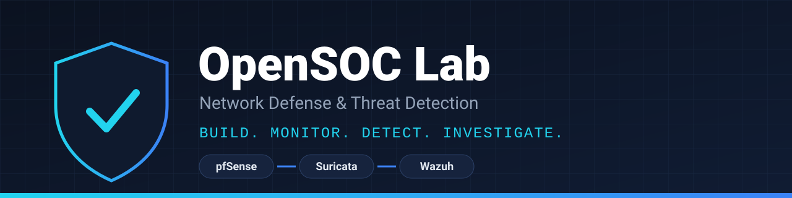
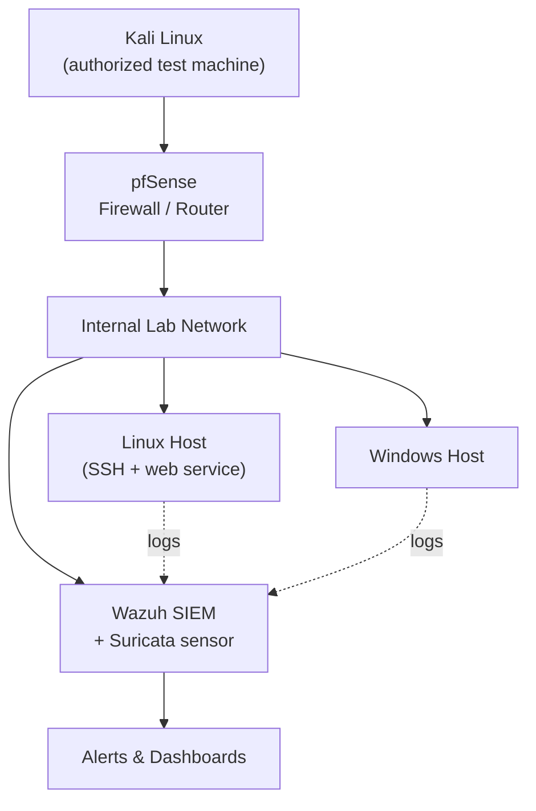

<p align="center">
  
</p>

<p align="center">
  
  
  
  
  
  
  
  
</p>

# OpenSOC Lab — Network Defense & Threat Detection

**Build. Monitor. Detect. Investigate.**

OpenSOC Lab is a hands-on cybersecurity lab designed to demonstrate network defense, intrusion detection, centralized security monitoring, and incident investigation in an isolated virtual environment.

The project integrates **pfSense**, **Suricata IDS**, and **Wazuh SIEM** to explore how security tools work together to monitor network activity, detect suspicious behavior, collect endpoint logs, and support incident response.

> **Project status:** In development. Features are marked as completed only after they have been implemented and validated.

## Table of Contents

- [Objectives](#objectives)
- [Architecture](#architecture)
- [Network Plan](#network-plan)
- [Technology Stack](#technology-stack)
- [Security Monitoring Workflow](#security-monitoring-workflow)
- [Planned Security Tests](#planned-security-tests)
- [Detection Matrix](#detection-matrix)
- [Repository Structure](#repository-structure)
- [Implementation Roadmap](#implementation-roadmap)
- [Expected Deliverables](#expected-deliverables)
- [Lab Constraints](#lab-constraints)
- [Lessons Learned](#lessons-learned)
- [Disclaimer](#disclaimer)

## Objectives

- Configure firewall rules and network segmentation using pfSense.
- Deploy Suricata to detect suspicious network traffic.
- Centralize and analyze security events using Wazuh.
- Collect and investigate Linux and Windows endpoint logs.
- Run controlled security tests in an isolated lab.
- Document alerts, findings, and remediation recommendations.

## Architecture

The planned environment consists of a firewall, an IDS sensor, a SIEM platform, and test endpoints.



*This is a conceptual overview. The final topology and Suricata sensor placement will be documented after implementation and testing.*

## Network Plan

> These addresses are **provisional**. They must be checked for conflicts before implementation, and the lab must stay isolated from home, university, and public networks.

| Machine | Role | Zone | IP Address |
|---|---|---|---|
| pfSense | Firewall / router | Test side / LAN | `192.168.56.1` / `10.10.10.1` |
| Kali Linux | Authorized test machine | Test side | `192.168.56.10` |
| Wazuh SIEM | SIEM (+ Suricata) | LAN | `10.10.10.10` |
| Linux target | Monitored endpoint | LAN | `10.10.10.20` |
| Windows target | Monitored endpoint | LAN | `10.10.10.30` |

## Technology Stack

| Component | Purpose |
|---|---|
| pfSense | Firewall, traffic filtering, access-control rules, segmentation |
| Suricata | Network intrusion detection (NIDS) |
| Wazuh | Security event collection, analysis, and alerting |
| Linux | Server logging, authentication monitoring |
| Windows | Windows event collection and monitoring |
| Kali Linux | Controlled test traffic generation |
| VMware Workstation | Virtual lab environment |

## Security Monitoring Workflow

1. Test traffic is generated inside the isolated lab.
2. pfSense applies the configured firewall rules.
3. Suricata inspects the traffic visible at its sensor interface and generates detection events.
4. Linux and Windows endpoints generate operating-system and authentication logs.
5. Wazuh collects and analyzes endpoint logs and integrated Suricata events.
6. The analyst examines alerts, investigates evidence, and documents findings.
7. Remediation is developed and detection is retested.

> Traffic visibility and log integration are validated experimentally. Installing a sensor does not automatically guarantee visibility into every packet.

## Planned Security Tests

- **SSH authentication monitoring:** Generate controlled failed-login events against the lab Linux server and check whether they produce the expected detections.
- **Web traffic monitoring:** Generate controlled traffic against a lab web service. Examine firewall logs, Suricata events, and application or endpoint logs, and distinguish normal high-volume traffic from traffic that truly triggers a detection.
- **Detection validation:** Compare generated activity with firewall logs, Suricata events, and Wazuh alerts.
- **Incident investigation:** Document evidence, analysis, and recommended remediation.

A single-source traffic flood is described as a **DoS** or application-layer flood, not automatically as a DDoS attack.

All tests run only against authorized lab systems in an isolated environment.

## Detection Matrix

Results will be added here after each test is executed and verified.

| Test | Objective | Expected Detection | Observed Events | Alert Time / Delay | False Positive / Missed | Remediation |
|---|---|---|---|---|---|---|
| SSH failed logins | _TBD_ | _TBD_ | _TBD_ | _TBD_ | _TBD_ | _TBD_ |
| Web traffic flood | _TBD_ | _TBD_ | _TBD_ | _TBD_ | _TBD_ | _TBD_ |

## Repository Structure

```text
OpenSOC-Lab/
├── README.md
├── assets/
│   └── banner.svg
├── docs/
│   ├── architecture.md
│   ├── network-design.md
│   ├── detection-matrix.md
│   └── troubleshooting.md
├── configs/
│   ├── pfsense/
│   ├── suricata/
│   └── wazuh/
├── tests/
│   ├── ssh-authentication/
│   └── web-traffic/
├── reports/
├── screenshots/
└── LICENSE
```

*Directories and files will be added as the project progresses.*

## Implementation Roadmap

- [ ] Phase 1 — Prepare the lab environment and verify host connectivity.
- [ ] Phase 2 — Design and validate the virtual network.
- [ ] Phase 3 — Configure pfSense firewall rules.
- [ ] Phase 4 — Deploy and validate Suricata (including packet visibility).
- [ ] Phase 5 — Deploy Wazuh and connect endpoint agents.
- [ ] Phase 6 — Generate controlled test events and validate detections.
- [ ] Phase 7 — Write incident reports and document results.
- [ ] Phase 8 — Finalize documentation and publish the portfolio version.

## Expected Deliverables

- Network architecture and IP addressing documentation.
- Configured and tested firewall rules.
- Verified Suricata event generation.
- Wazuh monitoring with Linux and Windows log collection.
- Controlled test procedures and results.
- Detection matrix mapping test activity to observed alerts.
- Incident reports with evidence and remediation recommendations.
- Sanitized configuration files and setup documentation.
- Screenshots of verified dashboards and alerts.
- Troubleshooting notes and lessons learned.

## Lab Constraints

The lab runs on two Windows PCs with limited RAM (about 8 GB each) and limited disk space, using VMware Workstation. The design therefore keeps the number of VMs and services to a minimum and tracks resource usage. Host-only VMware networks do not connect virtual machines across separate physical computers, so the cross-host network design is documented in `docs/network-design.md`.

## Lessons Learned

_To be completed during implementation._

## Disclaimer

This repository is intended for educational and defensive cybersecurity purposes. Security testing must be restricted to systems you own or have explicit permission to test. Attack simulations must remain within the isolated lab environment. Configuration files and screenshots are sanitized to remove credentials, tokens, and sensitive network information.
